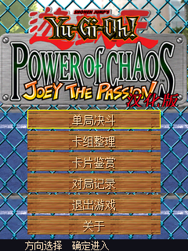
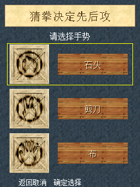
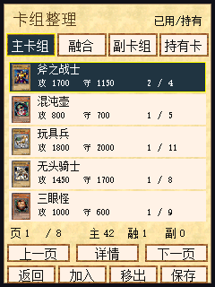
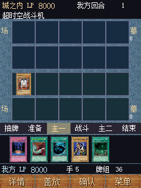
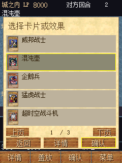
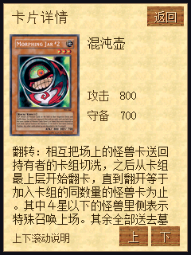

# 游戏王 · BBK 9588 竖屏移植

将 [HelloClyde/BBKH1-yugioh](https://github.com/HelloClyde/BBKH1-yugioh) 的原生 C 游戏移植到 **BBK 9588 / C200，240×320 竖屏**。保留原规则、AI、1,115 条卡片数值记录、猜拳、组牌、收藏、战绩与双槽存档，使用 9588 原生界面、文件和 PCM 接口。

当前版本：`0.1.0-alpha.1`，按预发布版提供。下述命令也可在本地生成可安装的成品。**尚未进行 9588 真机测试**，验证范围见 [验证记录](docs/VERIFICATION.md)。

## 快速开始

使用成品时，从 [Releases](https://github.com/HelloClyde/BBK9588-yugioh/releases/tag/v0.1.0-alpha.1) 下载 **`BBK9588-yugioh-v0.1.0-alpha.1-full.zip` 完整安装包**，直接解压到设备 A 盘根目录，得到：

```text
A:\应用\程序\游戏王.bda
A:\YUGIOH\FONT.BIN
A:\YUGIOH\H1UI.PAK
A:\YUGIOH\H1ART.PAK
A:\YUGIOH\H1SCN.PAK
A:\YUGIOH\H1SND.PAK
```

**完整安装包已经包含全部五个运行资源，无需另下资源包。** 刷新桌面后，从“娱乐天地”启动“游戏王”。也支持 B 盘同名资源目录，优先 A 盘。完整安装说明见 [完整包安装](docs/INSTALL-FULL.md)。

已单独下载 BDA 的使用者可配合 `BBK9588-yugioh-v0.1.0-alpha.1-resources.zip`，同样解压到 A 盘根目录。原 `BBK9588-yugioh.zip` 是保留的 **不带资源的 CI 程序包**，仅复制其中 BDA 不能运行；它的手动安装及存档迁移说明见 [INSTALL.md](INSTALL.md)。源码不收录五个 BIN/PAK，增补资源与完整包的来源和校验见 [资源发布说明](docs/RESOURCE_RELEASE.md)。

方向键选择、确定执行、返回关闭页面；决斗中返回打开菜单。点卡片先选中，再点执行；底部“盖放”切换盖放模式，“详情”查看选中牌。选牌弹窗提供“返回 / 详情 / 确认”，方向右键也能看当前高亮牌；返回保留选项和页码。手牌超过六张时可左右翻页，长卡片说明可上下滚动。

卡组整理保持每页五行及原字号（卡名 12 像素、数值 10 像素）。猜拳从原包分别取出手势图块，选择页等比例显示，结果页使用原尺寸。游戏内继续利用原来的卡图、字体、木纹、纸张和音乐；公开桌面图标为另行生成的原创几何图案。

开发者在本仓库目录执行（Windows / PowerShell）：

```powershell
git submodule update --init -- sdk upstream
python -m pip install -r requirements-build.txt
./sdk/scripts/setup_toolchain.ps1
python build.py
python tools/check_release.py
```

只初始化这两个子模块，不需要递归取得 SDK 的模拟器或上游 H1 SDK。工具链也可自行准备，用 `python build.py --toolchain <工具链bin目录>` 或 `MIPS_GNU_BIN` 指定；编译器必须是 MIPS GNU GCC 15.2.0。`--sdk` / `BDA_SDK_ROOT` 可指定其他目录，但仍要求固定提交和干净的 SDK 内容。

公开构建完全不读取商业资源。需要做本地完整画面/音频测试时，可以额外导入自己的原资源：

```powershell
python tools/import_assets.py --directory <原资源目录>
# 或：python tools/import_assets.py --archive <自己的资源ZIP>
python -m pip install -r requirements-test.txt
python tools/test_host.py --cc gcc --assets .local-assets
```

上述尖括号参数需替换为自己的本地路径；导入工具逐个验证固定上游的大小与 SHA-256，不下载资源。`.local-assets/` 与本地生成物均被 Git 排除。

需要自行打包完整安装 ZIP 时，用已验证的 BDA 成品和本地资源执行 [资源发布说明](docs/RESOURCE_RELEASE.md) 中的 `tools/package_resources.py`；脚本保持程序字节不变，不重编译游戏。

## 截图

以下均为本移植版在完整 9588 固件模拟器中的实际运行画面，来自已经验证的设备代码；不是效果图或其他项目截图。第三方画面不适用本仓库的代码许可证。

| 主菜单 | 猜拳 | 卡组整理 |
|---|---|---|
|  |  |  |

| 对局 | 选牌列表 | 选中牌详情 |
|---|---|---|
|  |  |  |

## 依赖

| 依赖 | 固定版本 / 用途 |
|---|---|
| 运行环境 | BBK 9588 / C200，240×320；完整安装 ZIP 已包含五个兼容资源，哈希见固定上游 `assets/reference-manifest.json` |
| 9588 SDK | `sdk/` 子模块，[bbk9588-bda-sdk](https://github.com/HelloClyde/bbk9588-bda-sdk)，`f2fcbe020e7e94014c33d7e5c593802e4b1e3034` |
| 上游游戏源码 | `upstream/` 子模块，[BBKH1-yugioh](https://github.com/HelloClyde/BBKH1-yugioh)，`f1e83a84d8a9dbe686bb1eef064118e409b46274` |
| 编译器 | MIPS GNU GCC 15.2.0；SDK 安装器固定下载包 SHA-256，不随游戏发布 |
| 构建脚本 | Python ≥3.10，CI 配置 Python 3.12；Pillow 12.3.0、pyelftools 0.33，见 `requirements-build.txt` |
| 主机规则 / UI 测试 | 本机 GCC；`python tools/test_host.py --cc gcc`，默认不需要商业资源或 SDK 工具链 |
| 可选完整画面 / 音频测试 | 使用者本地原资源、requests 2.34.2、NumPy 2.3.5；固件和模拟器须自行准备，不属于构建依赖 |

固定 SDK 尚未公开的存档全局刷写入口由应用内兼容封装提供，未携带 SDK 工作区的其他改动；见 [SDK 兼容说明](docs/SDK_COMPATIBILITY.md)。

## 构建与发布

`tools/prepare.py` 从固定且未修改的上游源码提取游戏语义逻辑，替换为 `src/` 的竖屏渲染和输入。生成的 C、ELF、链接图及构建清单保存在 `build/`。入口 `0x81c00020`，使用 soft-float；BSS 完整随载入映像分发并在入口清零。

源码 CI 成品为 `dist/Yugioh9588.bda`、不带资源的 `dist/BBK9588-yugioh.zip`、`dist/BUILD.json`、`dist/SHA256SUMS.txt`。Release 另附 `-full.zip` 完整安装包、`-resources.zip` 独立资源包及 `RESOURCE_BUILD.json` / `RESOURCES-SHA256SUMS.txt`。ZIP 使用固定条目顺序、时间和明确文件清单；不把开发目录整体压缩，也不包含任何个人存档。`BUILD.json` 区分静态构建校验和模拟器验证，CI 编译成功不等于游戏已经做过整机测试。

[Actions 工作流](.github/workflows/build-release.yml) 为 main、PR、手动运行构建并上传临时 artifacts；`v<VERSION>` 标签通过校验后使用同一次构建的产物创建预发布 / Release。发布 job 单独具有写权限，遇到已有同名 Release 会停止，不默认覆盖资产。具体发布步骤见 [发布说明](docs/RELEASING.md)，远端构建和发布状态以对应提交的 [Actions 运行结果](https://github.com/HelloClyde/BBK9588-yugioh/actions) 为准。

## 感谢

- **HelloClyde 及上游贡献者**：原生 H1 兼容实现、规则、AI、卡组与音频基础，以及 BBK 9588 SDK 和模拟器。
- **MrDefinition1999 及 bbk-h1-bda-sdk 贡献者**：上游 H1 项目的 SDK 基础；9588 版本直接使用固定的 9588 SDK。
- **KONAMI 与原游戏各权利人**：《Yu-Gi-Oh! Power of Chaos: Joey the Passion》及相关角色、图像与音频。
- **游戏王汉化制作组**：原汉化版本署名。本次没有取得更完整的贡献名单或第三方资源再分发授权。

致谢不替代许可证或素材授权。自有代码采用 [Apache-2.0](LICENSE)，第三方素材、字库、上游代码和模拟器补丁分别按 [来源声明](SOURCE_NOTICE.md) 处理。
